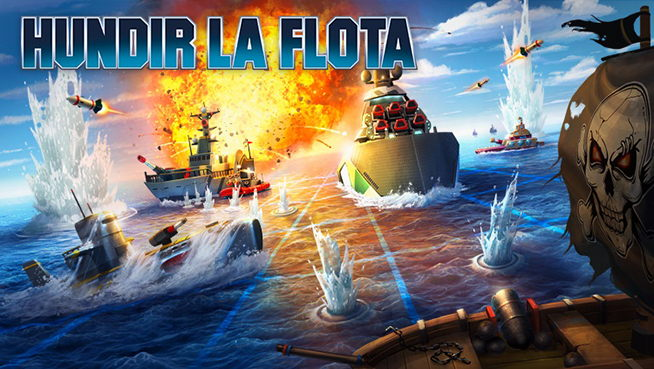

# JUEGO_HLF
Juego de Hundir la Flota codificado en Python utilizando la librería de NumPY

# 🚢 Hundir la Flota (Battleship) — Edición Terminal en Python

Proyecto de desarrollo del clásico juego de estrategia naval **Hundir la Flota**, diseñado bajo el paradigma de **Programación Orientada a Objetos (POO)**, arquitectura modular y cálculo matricial mediante **NumPy**.

---

## 📋 1. Descripción del Juego y Reglas Oficiales

El objetivo del juego es descubrir y hundir la totalidad de la flota enemiga (controlada por la Inteligencia Artificial de la máquina) antes de que esta logre hundir la flota propia.

### Composición de la Flota
Cada contendiente dispone de **6 embarcaciones** posicionadas aleatoriamente al inicio de la partida en una cuadrícula de **10x10**:
* **1 Acorazado** de **4 casillas** de eslora.
* **2 Cruceros** de **3 casillas** de eslora cada uno.
* **3 Destructores** de **2 casillas** de eslora cada uno.
* **Total de casillas de flota:** 16 puntos de impacto por jugador.

### Normas de Posicionamiento Espacial
1. **Límites:** Ninguna embarcación puede rebasar los bordes del tablero (filas y columnas de `0` a `9`).
2. **No superposición:** Dos barcos no pueden compartir una misma coordenada.
3. **Perímetro de seguridad:** Entre dos barcos cualesquiera debe existir siempre al menos **1 casilla de separación** tanto en horizontal como en vertical.

### Dinámica de Turnos y Simbología
En la terminal se visualizan siempre **únicamente los dos tableros del jugador** en paralelo, limpiando el historial previo en cada turno para ofrecer una interfaz despejada:
* **Tablero Izquierdo (`MI TABLERO DE BARCOS`):** Muestra la posición de la flota propia y los impactos recibidos por parte de la máquina.
* **Tablero Derecho (`MI TABLERO DE DISPAROS`):** Actúa como radar táctico donde se registran los disparos efectuados contra la máquina.

| Símbolo | Color en Terminal | Significado |
| :---: | :---: | :--- |
| `_` | Azul Brillante | Agua aún no explorada |
| `O` | Blanco Brillante | Casilla ocupada por un barco intacto |
| `A` | Azul Brillante | Agua (disparo fallido en el mar) |
| `X` | Rojo Intenso | Tocado (impacto efectivo sobre un barco) |

* **Repetición de turno:** Si un jugador impacta sobre un barco rival (`X`), conserva la iniciativa y vuelve a disparar de forma consecutiva hasta que falle (`A`).
* **Condición de victoria:** La partida concluye en el instante en que todas las casillas `'O'` de un jugador pasan a ser `'X'`. Si vence el jugador humano, se revela el tablero oculto de la máquina junto con un mensaje de felicitación; si vence la máquina, se muestra el tablero final del jugador humano.

---

## 🏗️ 2. Arquitectura del Proyecto

El sistema sigue el principio de **Separation of Concerns (SoC)** dividido en cuatro módulos de código:

1. **`variables.py`:** Define constantes dimensionales, estructura de la flota y códigos de escape ANSI (`colorama`).
2. **`funciones.py`:** Implementa la lógica matricial sobre `numpy.ndarray` (`crear_tablero`, `crear_barco`, `validar_posicion_barco`, `colocar_barco`, `colocar_barcos` y `disparar`).
3. **`utils.py`:** Contiene las clases `Tablero`, `Jugador` y `JuegoHundirLaFlota`, así como los motores de renderizado en consola y el modo demostración.
4. **`main.py`:** Punto de entrada ejecutable desde terminal que gestiona el menú principal.

---

## 🚀 3. Instrucciones de Ejecución en Visual Studio Code

1. Abra la carpeta del proyecto en **Visual Studio Code**.
2. Instale las librerías necesarias desde la terminal integrada:
   ```bash
   pip install numpy colorama ipykernel
   ```
3. Inicie el programa ejecutando:
   ```bash
   python main.py
   ```
4. Elija en el menú interactivo la **Opción 1** para disputar una partida completa o la **Opción 2** para lanzar la demostración guiada.
